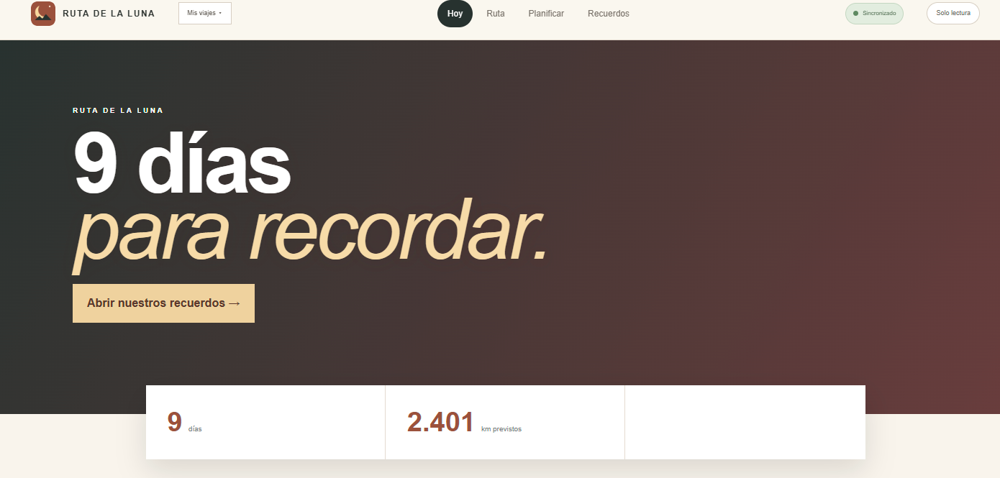

# Ruta de la Luna

**Un planificador de viaje colaborativo para organizar el recorrido, las actividades y los recuerdos desde un solo lugar.**

Proyecto de producto y portfolio con una demo pública de solo lectura.

## Demo

[Explorar la demo de Ruta de la Luna](https://ruta-de-la-luna.mnoero.chatgpt.site/)

La demo presenta un itinerario de ejemplo y no está destinada a gestionar reservas reales.



## Qué permite organizar

- Itinerario por día con rutas, distancias y tiempos estimados.
- Alojamientos, excursiones y decisiones pendientes.
- Gastos compartidos en ARS y USD.
- Recuerdos del viaje con fotografías.
- Vista adaptable a escritorio y móvil, con soporte PWA para conectividad limitada.

## Tecnologías

Next.js 16 · React 19 · TypeScript · Leaflet · Cloudflare Workers · D1 · R2 · Drizzle ORM · Vite · Vinext

## Estado y privacidad

Este repositorio contiene una versión pública preparada para portfolio. La demo utiliza información ilustrativa; no debe utilizarse para coordinar viajes, pagos o reservas reales. Los contactos y datos privados del viaje original fueron excluidos del material publicado.

El repositorio es público y la demo se encuentra disponible en modo de solo lectura.

## Desarrollo local

```bash
npm install
cp .env.example .env.local
npm run dev
```

La aplicación puede ejecutarse en modo demostración sin credenciales. La edición y persistencia requieren los bindings `DB` (D1), `BUCKET` (R2) y la variable `EDIT_CODE`.

## Autor

[Matías Noero](https://github.com/mnoero23)
